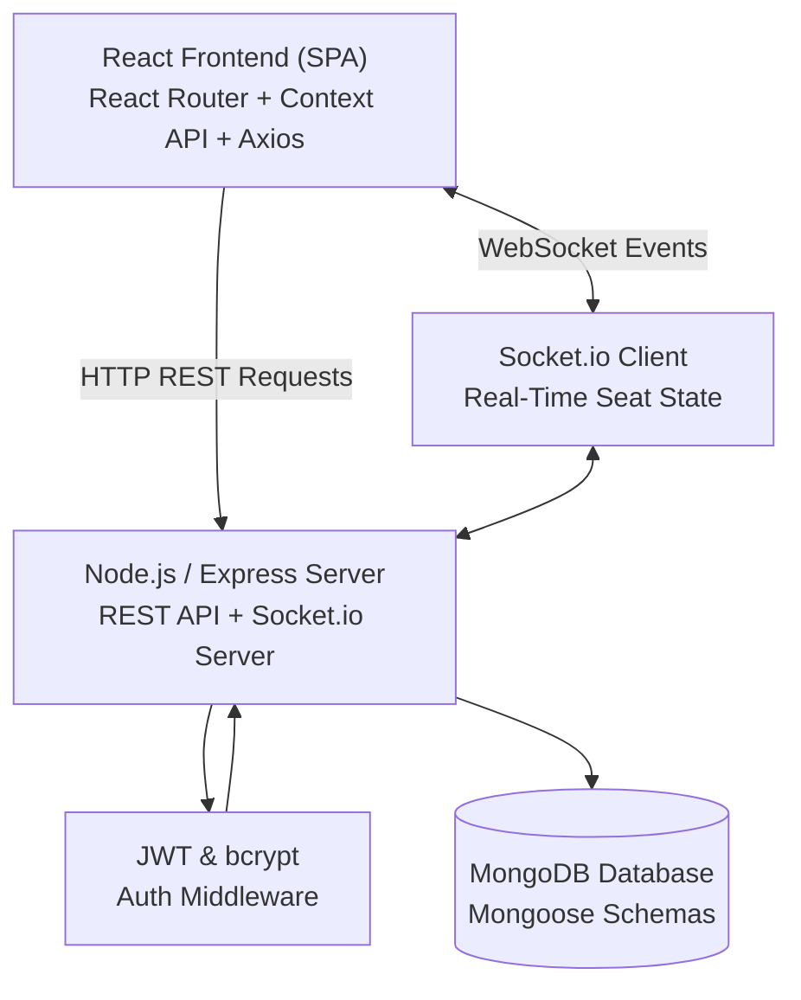
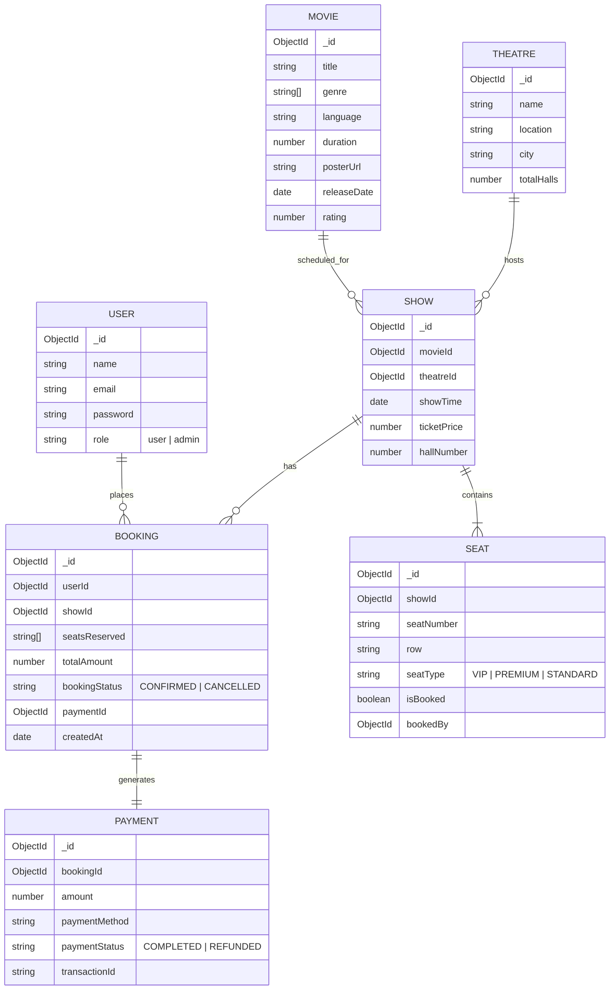

# IMovies - Movie Ticket Booking Made Simple

A full-stack **MERN (MongoDB, Express.js, React.js, Node.js)** college capstone project for movie ticket booking with real-time seat reservation via **Socket.io**, role-based authentication, mock checkout payment processing, digital e-ticketing, and an administration dashboard.

---

## 📽️ Project Highlights & Features

- **Authentication & RBAC**: Secure JWT-based authentication with bcrypt password hashing and role-based access control (`user` vs `admin`).
- **Real-Time Seat Reservation (Socket.io)**: Interactive cinema matrix with instant seat-lock synchronization across concurrent user sessions.
- **Seat Tier Pricing**: Dynamic pricing engine calculating VIP (+30%), Premium (+15%), and Standard seat classes.
- **Mock Payment Gateway**: Realistic payment checkout supporting Credit/Debit Card, UPI (VPA), and Net Banking with unique transaction IDs (`TXN-XXXXXX`).
- **Digital E-Tickets**: Printable booking pass with generated barcode/QR code representation, auditorium information, and seat details.
- **User Dashboard**: Overview of Upcoming & Past bookings with one-click **cancellation and seat release with automated refund status**.
- **Admin Control Panel**:
  - Movie Catalogue CRUD (Title, Genre, Duration, Poster, Trailer/Banner, Rating, Release Date).
  - Theatre Management (Complex name, city, location, hall counts).
  - Show Scheduling (Automated generation of 60 cinema seats for every scheduled screening).
  - Customer Bookings Ledger & Revenue Analytics.

---

## 🏗️ Architecture & Component Flow



---

## 🗄️ Database Schemas (Mongoose)



---

## 📁 Directory Structure

```
antigravity/
├── package.json               # Root scripts
├── README.md                  # Project documentation & presentation points
├── server/                    # Node.js + Express + MongoDB Backend
│   ├── .env                   # Server environment configuration
│   ├── package.json
│   ├── server.js              # Express app & Socket.io server
│   ├── config/
│   │   └── db.js              # MongoDB Mongoose connection
│   ├── models/                # 7 Mongoose Schemas
│   │   ├── User.js
│   │   ├── Movie.js
│   │   ├── Theatre.js
│   │   ├── Show.js
│   │   ├── Seat.js
│   │   ├── Booking.js
│   │   └── Payment.js
│   ├── middleware/
│   │   ├── authMiddleware.js  # JWT protect & adminOnly guards
│   │   ├── errorHandler.js    # Global error handler
│   │   └── upload.js          # Multer storage configuration
│   ├── controllers/
│   │   ├── authController.js
│   │   ├── movieController.js
│   │   ├── theatreController.js
│   │   ├── showController.js
│   │   ├── seatController.js
│   │   └── bookingController.js
│   ├── routes/
│   │   ├── authRoutes.js
│   │   ├── movieRoutes.js
│   │   ├── theatreRoutes.js
│   │   ├── showRoutes.js
│   │   ├── seatRoutes.js
│   │   └── bookingRoutes.js
│   ├── utils/
│   │   ├── generateToken.js   # JWT signing utility
│   │   └── seatGenerator.js   # Automated 60-seat layout creator
│   └── scripts/
│       └── seedData.js        # Comprehensive mock database seeder
└── client/                    # React Frontend
    ├── .env                   # Client environment configuration
    ├── package.json
    ├── public/
    │   └── index.html         # Bootstrap 5 & Google Fonts
    └── src/
        ├── index.js
        ├── App.js             # Route configurations & Providers
        ├── index.css          # Cinematic dark mode design & seat matrix styles
        ├── App.css
        ├── api/
        │   └── axiosInstance.js
        ├── context/
        │   ├── AuthContext.js
        │   └── SocketContext.js
        ├── components/
        │   ├── Navbar.js
        │   ├── Footer.js
        │   ├── ProtectedRoute.js
        │   ├── AdminRoute.js
        │   ├── MovieCard.js
        │   └── SeatMatrix.js  # Real-time cinema seat grid
        └── pages/
            ├── Home.js
            ├── MovieDetails.js
            ├── SeatSelection.js
            ├── Checkout.js
            ├── BookingConfirmation.js
            ├── UserDashboard.js
            ├── Login.js
            ├── Register.js
            └── admin/
                ├── AdminDashboard.js
                ├── ManageMovies.js
                ├── ManageTheatres.js
                ├── ManageShows.js
                └── ManageBookings.js
```

---

## ⚡ Step-by-Step Setup Guide

### 1. Prerequisites
- **Node.js** (v18 or higher): [https://nodejs.org](https://nodejs.org)
- **MongoDB** (Local Community Server or MongoDB Atlas cluster): [https://www.mongodb.com](https://www.mongodb.com)

---

### 2. Backend Setup
1. Open a terminal and navigate to the `server/` directory:
   ```bash
   cd server
   ```
2. Install server dependencies:
   ```bash
   npm install
   ```
3. Configure the `.env` file (pre-configured with defaults):
   ```env
   PORT=5000
   NODE_ENV=development
   MONGO_URI=mongodb://127.0.0.1:27017/imovies_db
   JWT_SECRET=imovies_super_secret_jwt_key_2026_xyz
   CLIENT_URL=http://localhost:3000
   ```
4. **Seed the Database** with mock movies, theatres, showtimes, seats, and accounts:
   ```bash
   npm run seed
   ```
5. Start the backend server:
   ```bash
   npm run dev
   # or
   npm start
   ```
   *The server runs at `http://localhost:5000`.*

---

### 3. Frontend Setup
1. Open a second terminal window and navigate to the `client/` directory:
   ```bash
   cd client
   ```
2. Install client dependencies:
   ```bash
   npm install
   ```
3. Check the client `.env` file:
   ```env
   REACT_APP_API_URL=http://localhost:5000/api
   REACT_APP_SOCKET_URL=http://localhost:5000
   ```
4. Start the React development server:
   ```bash
   npm start
   ```
   *The React application will launch in your browser at `http://localhost:3000`.*

---

## 🔑 Demo Login Credentials

For quick evaluation or live college viva demonstrations, the login page contains quick-fill buttons:

| Role | Email | Password | Privileges |
| :--- | :--- | :--- | :--- |
| **Admin** | `admin@imovies.com` | `admin123` | Full access to Admin Panel, create/edit movies, manage theatres, schedule shows, audit all customer bookings. |
| **User** | `user@imovies.com` | `user123` | Browse catalog, select seats in real-time, complete mock checkout, view e-tickets, cancel bookings. |

---

## 📡 REST API Reference

### 1. Authentication (`/api/auth`)
- `POST /api/auth/register` - Create account (`name`, `email`, `password`, `role`).
- `POST /api/auth/login` - Authenticate and obtain JWT token.
- `GET /api/auth/profile` - Get authenticated user profile *(Private)*.

### 2. Movies (`/api/movies`)
- `GET /api/movies` - Query movies with filters (`?search=&genre=&language=`).
- `GET /api/movies/:id` - Fetch single movie details.
- `POST /api/movies` - Create movie *(Admin only)*.
- `PUT /api/movies/:id` - Update movie *(Admin only)*.
- `DELETE /api/movies/:id` - Delete movie and cascade purge shows & seats *(Admin only)*.
- `POST /api/movies/upload` - Upload poster image via Multer *(Admin only)*.

### 3. Theatres (`/api/theatres`)
- `GET /api/theatres` - Query theatres (optional `?city=` filter).
- `GET /api/theatres/:id` - Get theatre details.
- `POST /api/theatres` - Create theatre *(Admin only)*.
- `PUT /api/theatres/:id` - Update theatre *(Admin only)*.
- `DELETE /api/theatres/:id` - Delete theatre *(Admin only)*.

### 4. Shows & Screenings (`/api/shows`)
- `GET /api/shows` - Query shows (`?movieId=&theatreId=&date=&city=`).
- `GET /api/shows/:id` - Get show info.
- `POST /api/shows` - Schedule show + **auto-generate 60 seats** *(Admin only)*.
- `DELETE /api/shows/:id` - Cancel show & seats *(Admin only)*.

### 5. Seats (`/api/seats`)
- `GET /api/seats/show/:showId` - Fetch real-time seat matrix for a show.

### 6. Bookings & Payments (`/api/bookings`)
- `POST /api/bookings` - Reserve seats, create payment record, mark seats booked, broadcast Socket.io event *(Private)*.
- `GET /api/bookings/my` - Fetch current user's booking history *(Private)*.
- `GET /api/bookings/:id` - Get full e-ticket data *(Private)*.
- `PUT /api/bookings/:id/cancel` - Cancel booking, release seats, refund payment *(Private)*.
- `GET /api/bookings` - Audit all customer bookings *(Admin only)*.

---

## 🎓 College Viva & Presentation Highlights

1. **Concurrency and Double-Booking Prevention**:
   Before confirming a booking in `bookingController.js`, an atomic database validation checks if any requested seat in `seatNumbers` has `isBooked: true`. If another user booked it milliseconds earlier, the transaction is rejected with an explanatory message.
2. **WebSocket Integration via Socket.io**:
   When any user confirms or cancels a booking, a targeted socket event (`seatsUpdated`) is emitted to the room `show_${showId}`. All open browsers on that seat matrix update without refreshing the page.
3. **Mongoose Relational Population**:
   Deep population chains (`Booking -> Show -> Movie & Theatre`, `Payment`) demonstrate mastery of NoSQL referencing and document modeling.
4. **Clean UI/UX Design System**:
   Custom cinematic dark mode palette, CSS variables, screen curve indicator, seat status badges, and printable e-ticket format.
